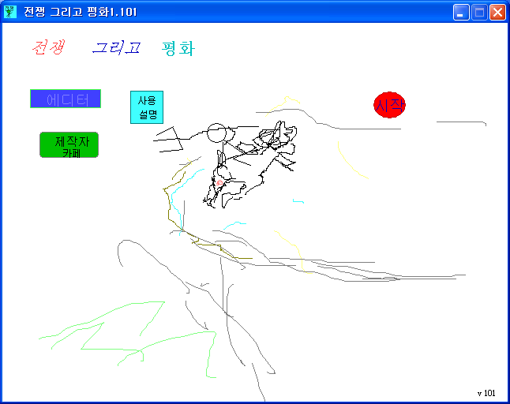
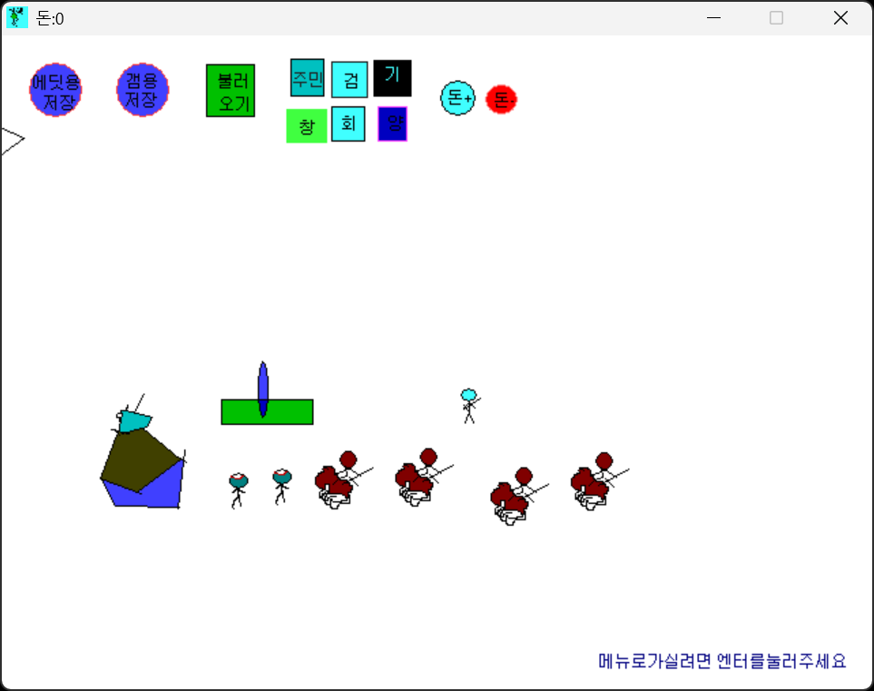

# War and Peace

[한국어](README.ko.md)

An RTS made in GameMaker. Villager, swordsman, spearman and cavalry units and hall and barracks buildings are divided between two factions, and a map editor was built alongside the game.

  
  

## How to play

Download it from Releases and run it.

On the title screen, Start lets you pick a saved `.mak` map file and starts the game on that map. Editor opens the map editor.

In the editor, you pick units and buildings with the buttons along the top, place them on screen, and can adjust the starting funds. Maps are saved in two forms, one for editing and one for playing, and Load opens them again. The left and right arrow keys scroll the view.

## How it works

Map saving uses GameMaker's `game_save` as is. Instead of writing the coordinates and types of placed units into a file format of its own, it saves a snapshot of the whole game state, so the map editor worked without a save format ever being defined. The file dialog adds a `.mak` extension so the file looks like a map file.

Scrolling works by moving a small dummy object with the left and right arrow keys and having the view follow it.

## Files

| Path | Contents |
|---|---|
| `source/war-and-peace.gmk` | Original project file |
| `source/split/` | Text tree produced by GmkSplitter |
| `docs/screenshots/` | Screenshots |
| Releases | Files for distribution |

## License

CC BY-NC-ND 4.0. Unmodified copies may be shared for noncommercial purposes with attribution. Distributing modified versions and commercial use are not allowed. Bundled libraries, graphics, sounds, and maps made by other people keep their own rights. See [LICENSE](LICENSE).
